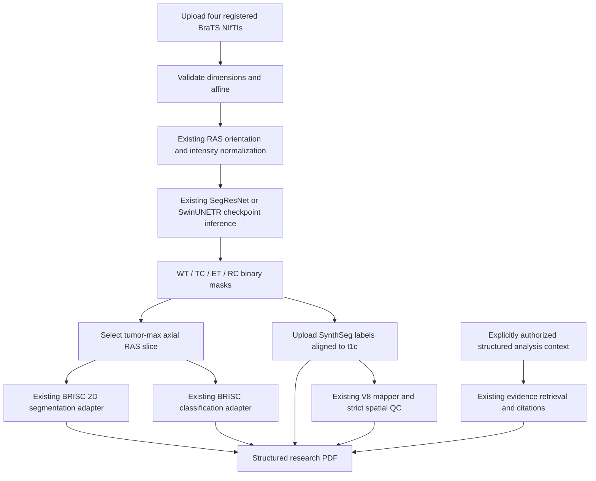

# Integrated MRI Research Pipeline

This is a separate orchestration and Streamlit interface over the existing
project. It does not replace either original implementation. It is a research
prototype, not a diagnostic or treatment-planning system.

## Component integration

| Pipeline component | Reused source | Contract and current limitation |
|---|---|---|
| 3D segmentation | `2_3d_segmentation/src/segmentation3d/monai_engine.py`, `2_3d_segmentation/src/segmentation3d/models.py`, `1_data_and_preprocessing/src/data/brats.py` | Existing `predict_case` loader; four registered BraTS modalities (`t2f`, `t1n`, `t1c`, `t2w`), RAS orientation, existing nonzero-voxel z-score normalization, verified checkpoint ontology required. |
| 3D region interpretation | `1_data_and_preprocessing/src/data/brats.py`, `2_3d_segmentation/configs/segmentation3d.yaml` | Independent, potentially overlapping WT/TC/ET/RC masks. They are not SynthSeg labels. |
| Slice extraction | New `modules/slice_extraction.py` | The `t1c` volume in the model's RAS-oriented input; tumor-max axial slice by default. The extracted 2D row/column indices map to the first/second array axes, and the slice index maps to the third. |
| 2D segmentation | `3_2d_segmentation/src/segmentation2d/model.py`, `3_2d_segmentation/src/segmentation2d/engine.py`, `1_data_and_preprocessing/src/data/brisc.py` | Reuses `BRISCUNet` checkpoint contract and training preprocessing (`256x256`, grayscale, `[0,1]`). MRI/BRISC domain compatibility is unvalidated. The existing CLI predictor uses a different normalization; the adapter follows training preprocessing instead. |
| 2D classification | `4_2d_classification/src/classification/model.py`, `4_2d_classification/src/classification/engine.py`, `1_data_and_preprocessing/src/data/brisc.py` | Reuses `BRISCClassifier` and four BRISC class names. MRI slice conversion to grayscale robust intensity range is a domain adaptation, not validated against the BRISC training distribution. Outputs must not be interpreted as a confirmed diagnosis. |
| Surgical risk mapping | `5_surgical_risk_mapping/configs/config_v7.json`, `5_surgical_risk_mapping/pipeline/run_patient.py`, `5_surgical_risk_mapping/pipeline/run_v8_pipeline.py`, `5_surgical_risk_mapping/pipeline/v7_risk_components.py` | Runs the existing V8 engine when a SynthSeg label volume is supplied and strict V8 spatial QC passes. Uses the uploaded t1c MRI and existing WT prediction mask. DTI/tract-dependent metrics remain unavailable unless those inputs are later integrated. BraTS region masks are never substituted for SynthSeg. |
| RAG | `6_rag_treatment_planning/api/main.py`, `6_rag_treatment_planning/src/rag_pipeline.py`, `6_rag_treatment_planning/src/schemas.py` | The API accepts a per-query validated structured context from this run; context is not persisted. With explicit authorization, structured outputs and the question are sent; raw MRI is not. RAG source corpus/service availability remains external and is not bundled reliably. |
| PDF report | New `modules/report_generator.py` | Generated from the run's stage statuses, actual model outputs, mask overlays and optional RAG response/citations. Missing/blocked stages are stated; no treatment recommendation is generated. |

## Data flow



## Setup and launch

From the repository root in PowerShell:

```powershell
python -m pip install -e ".[integrated]"
python -m streamlit run integrated_pipeline\app.py
```

The app requires four registered 3D `.nii` or `.nii.gz` volumes with matching
shape and affine, finite non-empty voxel data, in the displayed modality order. It preserves spatial
metadata and relies on the existing data loader to orient to RAS. The app does
not retrain models. Raw NIfTI `.nii` uploads are temporarily gzip-wrapped to
match the existing loader's expected case filenames. Supply a compatible 3D checkpoint with the existing
`brats_post_treatment_composites_v1` checkpoint ontology. Existing sample
checkpoints appear in the default fields when present; their existence does
not establish clinical validity or successful inference on an uploaded case.

The optional 2D checkpoints are the project’s BRISC research checkpoints.
Their use on MRI slices is experimental and out of distribution unless
validated separately. The adapters robustly scale each MRI slice from its
nonzero 1st-99th intensity percentiles; this differs from the original BRISC
image domain. The report labels their outputs as model predictions. The
selected 2D model input is the `t1c` modality and its displayed axis convention
is the RAS-oriented array convention, not a validated radiology workstation
viewing convention.

For the existing RAG agent, start its API separately using its
`6_rag_treatment_planning/README.md` instructions. The integrated app
passes the current run's structured output as a per-query context; the API does
not persist that context. It sends no raw MRI voxel data. The UI requires
explicit authorization before sending the study/context ID, structured
predictions, and question to the configured API. Verify the knowledge base and
the API's model-service configuration before use.
Model download/service configuration remains in the original RAG project;
ordinary integrated-app startup does not download a generation model.

## Optional V8 integration and prerequisites

The integrated pipeline runs V8 only when a separate SynthSeg label volume is
provided. The label volume must be registered to the uploaded t1c MRI; the
adapter reorients MRI and labels to RAS and checks dimensions, affine, integer
label values and known V8 label IDs. The V8 mapper then performs its original
strict spatial QC and halts on critical mismatches. V8 outputs are isolated
under the temporary run directory and removed after structured maps, component
weights, QC, structure scores and corridor cost records are retained in
session state. No SynthSeg labels are inferred from the BraTS segmentation.
The default integration does not provide DTI FA or tract masks, so those
component scores are unavailable and are surfaced as such. These geometric
and anatomical composite scores are not probabilities of injury and are not
clinically validated.

## Data handling, reproducibility, known limits

- Inputs are copied to a temporary directory for inference and removed when the
  run ends. Current result arrays remain in Streamlit session state until the
  session ends; they are not persisted to disk by this app.
- Run this app only in an environment authorized for the uploaded data. On a
  remote deployment, uploads are transmitted to that host; this prototype has
  no authentication, access-control or deployment-hardening layer. Do not
  expose it publicly or submit identifiable data without institutional
  authorization.
- Before public redistribution, have the project owner confirm licensing for
  source contributions, model checkpoints, datasets and literature documents.
  This integration does not grant rights to those materials.
- CPU inference is supported by the existing checkpoint loader but 3D inference
  can be slow and memory intensive. No model weights are downloaded by the app.
- The project’s 3D example checkpoint metadata records one completed training
  epoch. A checkpoint being present is not a performance or validation claim.
- 3D outputs carry the existing provisional BraTS region ontology; the source
  metadata marks label-release provenance unverified.
- No ground truth is expected for uploads; all displayed masks are predictions.
- The risk stage runs only with user-supplied SynthSeg labels and strict QC
  passing; it reports blocked/failed states otherwise. RAG requires an
  available service and explicit authorization. These stages are not claimed
  as end-to-end tested.
- The RAG project defaults to local Ollama `llama3.2:3b`, separately from its
  embedding and reranking models. This integration does not select or replace
  those models; no larger model is silently downloaded.
- The generation model is configured independently through the legacy RAG
  service's `OLLAMA_MODEL`; retrieval embeddings and reranking use their own
  `EMBEDDING_MODEL` and `RERANKER_MODEL` settings. Candidate deployment choices:

  | Model | License | Practicality | Selection caveat |
  |---|---|---|---|
  | Qwen2.5 7B Instruct (`qwen2.5:7b`) | Apache-2.0 | Recommended demo candidate when several GB of memory plus runtime overhead are available; CPU inference may be slow. Ollama model pull is explicit. | Stronger instruction-following capacity is a reasonable candidate for grounded synthesis, but was not benchmarked in this project and is not clinically validated. |
  | Llama 3.2 3B (`llama3.2:3b`) | Llama 3.2 Community License; review its terms | Existing lower-memory local Ollama default and fallback. | Less capacity than the 7B candidate is expected; citations/evidence still require checking. |

  To try the Qwen model, set `OLLAMA_MODEL=qwen2.5:7b` in the RAG service
  environment and explicitly obtain its Ollama model before the demo. Ordinary
  app startup never downloads generation weights. The choice is configurable;
  no measured quality comparison or clinical evaluation is claimed.

## Tests

From repository root:

```powershell
python -m unittest integrated_pipeline.tests.test_pipeline -v
```

The tests use synthetic NIfTI volumes and do not run checkpoint inference,
external RAG services, or clinical validation.
